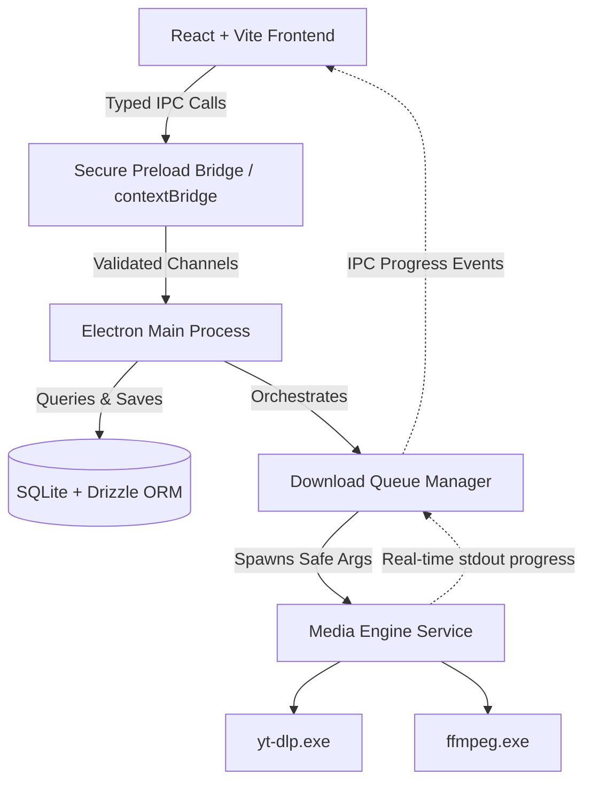

# DDX Downloader

<p align="center">
  <strong>Modern, high-performance, open-source desktop media suite for downloading YouTube videos, educational courses, playlists, and online media.</strong>
</p>

<p align="center">
  
  
  
  
  
  
</p>

---

## 🌟 Overview & Local-First Philosophy

**DDX Downloader** is a production-quality desktop application engineered to give users complete control over their downloaded educational lectures, courses, high-resolution videos, and audio.

- **100% Local-First**: Runs entirely on your local machine.
- **Zero Cloud Accounts**: No registrations, no logins, no personal backend server, no remote telemetry.
- **Offline Reliability**: Application settings, playlist history, and queue state are persisted locally in SQLite via Drizzle ORM.
- **Safe & Sandboxed**: Electron main and preload processes communicate via strictly validated, isolated IPC bridges.

---

## 🚀 Key Features

### 1. Smart URL Analysis
- Paste any video, course, or playlist link (supports **Ctrl+V** or 1-click clipboard paste).
- Automatically retrieves live formats, resolutions, audio streams, codecs, uploader details, and thumbnails.
- Supports **YouTube**, **Playlists & Courses**, **Instagram Reels**, **Vimeo**, **TikTok**, and thousands of supported websites via a modular provider architecture.

### 2. High-Resolution Video Selection
- Choose your preferred resolution: **Best Available**, **4K (2160p)**, **2K (1440p)**, **1080p Full HD**, **720p HD**, or **480p SD**.
- View container formats (**MP4**, **MKV**), approximate file sizes, and frame rates.
- Automatic merging of separate high-resolution video and audio streams using bundled FFmpeg.

### 3. Dedicated Audio Extraction
- Convert video streams to standalone audio tracks (**MP3 320kbps** or native **M4A / AAC**).
- Zero audio quality loss when keeping original audio streams.

### 4. Educational Course & Playlist Curriculum
- Complete curriculum browser for YouTube playlists and educational courses.
- **Curriculum Organization**: Automatically organizes courses into dedicated folders (e.g., `Downloads/Physics 101/01 - Electric Field.mp4`).
- Bulk selection tools: "Select All", "Deselect All", or custom lesson selection.
- Automatic zero-padded numerical lesson prefixes (`01 - `, `02 - `) to preserve chronological lecture order.

### 5. Real-Time Download Manager
- Live progress metrics: completion percentage, real-time download speed (MB/s), downloaded/total bytes, and calculated ETA.
- Queue orchestration with configurable maximum concurrent downloads.
- Non-destructive pause, resume, cancel, and retry capabilities.
- Interrupted downloads reconciliation: automatically cleans up interrupted jobs on application restarts.

### 6. Local Media Library & History Log
- Browse all downloaded media with responsive cards and search filters.
- Direct actions: **Play** in your default system media player or **Reveal** in local Windows Explorer folder.
- Safe deletion policy: removing items from your library or history never silently deletes files on disk without explicit user confirmation.

### 7. Engine Diagnostics & Dependency Management
- In-app dependency status panel for **yt-dlp** and **FFmpeg**.
- Seamless integration with bundled binaries, system PATH, or user-configured custom paths.

---

## 🏛 Architecture

DDX Downloader adheres to clean architectural separation between interface, lifecycle orchestration, and native media execution:



---

## 📦 Tech Stack

- **Desktop Framework**: Electron 45 (Main, Preload, Context Isolation)
- **Frontend**: React 19, TypeScript, Vite 8
- **Styling**: Tailwind CSS v4, Framer Motion, Lucide Icons
- **Local Database**: SQLite with Drizzle ORM (`sql.js` WASM engine for 100% portable cross-platform execution without requiring native C++ build tools)
- **Media Engines**: `yt-dlp` & `FFmpeg`
- **Testing**: Vitest & React Testing Library
- **Packaging**: `electron-builder` (NSIS installer & Portable x64 Windows binaries)

---

## 🛠 Getting Started

### Prerequisites
- [Node.js](https://nodejs.org/) v20+ or v24+
- `npm` v10+

### Installation & Development

1. **Clone the repository**:
   ```bash
   git clone https://github.com/DdxAhmed/Ddx-Downloader.git
   cd Ddx-Downloader
   ```

2. **Install dependencies**:
   ```bash
   npm install
   ```

3. **Start the application in development mode**:
   ```bash
   npm run dev
   ```

---

## 🧪 Running Automated Tests

Run the complete Vitest test suite covering URL safety validation, media providers, filename sanitization, SQLite migrations, queue management, and dependency diagnostics:

```bash
npm run test
```

To run TypeScript verification:
```bash
npm run typecheck
```

---

## 🏗 Building & Packaging for Windows

Build production bundles and Windows distributables:

```bash
# Build Vite frontend and Electron main process
npm run build

# Package Windows NSIS Installer and Portable executable
npm run dist
```

Outputs will be generated in the `./release` directory:
- `DDX Downloader Setup 1.0.0.exe` (Full Windows NSIS Installer)
- `DDX Downloader 1.0.0.exe` (Portable Single-file Executable)

---

## 🔒 Security Practices

- **Strict IPC Boundaries**: The renderer process runs with `nodeIntegration: false` and `contextIsolation: true`.
- **Safe Process Invocation**: yt-dlp and FFmpeg are executed exclusively via `child_process.spawn` with an array of arguments, never via shell command interpolation.
- **SSRF & Traversal Protection**: User-supplied URLs are strictly validated to public HTTP/HTTPS endpoints; loopback (`localhost`, `127.0.0.1`) and private LAN addresses are blocked.
- **Filename Sanitization**: Forbidden characters (`\ / : * ? " < > |`) and directory traversal sequences (`../`) are systematically stripped.

---

## 📄 License & Attributions

- **DDX Downloader** is open-source under the [MIT License](LICENSE).
- **yt-dlp**: Distributed under the [The Unlicense](https://github.com/yt-dlp/yt-dlp/blob/master/LICENSE).
- **FFmpeg**: Licensed under the [GNU LGPL v2.1+](https://www.ffmpeg.org/legal.html).
